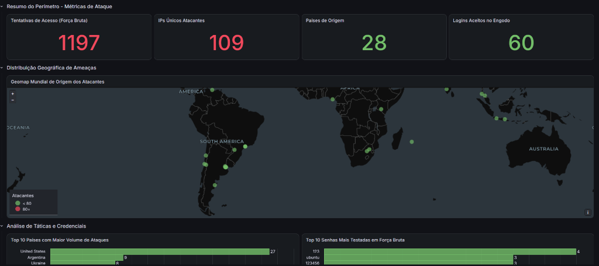

# AWS Cowrie Honeypot - Pipeline de Threat Intelligence, Forense de Malware e Observabilidade

Este projeto implementa uma solucao corporativa de Engenharia de Deteccao, Threat Intelligence, Analise Forense Automatizada de Malwares e Observabilidade na nuvem AWS. O ambiente expoe intencionalmente uma porta SSH de engodo (Honeypot Cowrie) para capturar varreduras, ataques de forca bruta, comandos interativos e payloads maliciosos da internet publica, processando esses eventos em um pipeline serverless resiliente com auto-recuperacao (self-healing) e exibindo a telemetria em tempo real no Grafana Cloud.

---

## 1. Arquitetura da Solucao

A solucao e dividida em seis camadas desacopladas, orientadas a eventos e protegidas por mecanismos de alta disponibilidade:

```text
[ Internet / Scanners / Atacantes / Botnets ]
       │
       ▼ (Porta TCP/22)
[ Host EC2 (t3.micro - Ubuntu 24.04 LTS) ]
  • Cowrie Honeypot isolado em container Docker (UID 999)
  • Daemon OpenSSH real movido para porta administrativa TCP/22022
  • Mount somente leitura de /etc/ssh/moduli para suporte a ciphers legados (DH-GEX)
  • Quarentena local de malwares com checagem de estabilizacao de download
  • Watchdog de auto-recuperacao (auto-start e recuperacao de jsonlog)
  • Sincronizador de logs com controle de cursor por inode e fatiamento via sed
       │
       ├─────────────────────────────────────────────┐
       ▼ (cowrie-logs/year=YYYY/month=MM/day=DD/)   ▼ (malware-samples/<sha256>)
[ Amazon S3 (Bucket Privado com Criptografia SSE-S3) ]
  • cowrie-logs/: logs brutos particionados em Hive
  • malware-samples/: binarios e scripts maliciosos em quarentena de nuvem
  • Lifecycle Rules dedicadas: expiracao automatica em 60 dias
       │
       ▼ (Gatilho nativo: s3:ObjectCreated:*)
[ AWS Lambda (Runtime Python 3.12 - 128 MB) ]
  • Roteamento inteligente de eventos (Logs Brutos vs. Amostras de Malware)
  • Trilha A (Logs):
      - Agregacao e deduplicacao de sessoes por IP
      - Enriquecimento paralelo (ThreadPoolExecutor) de GeoIP e AbuseIPDB
      - Caches em memoria thread-safe (Lock) com teto e protecao anticontaminacao
      - Guardiao de tempo limite (Deadline Guard de 10s para garantir escrita no S3)
  • Trilha B (Forense de Malware):
      - Inspecao estatica autonoma: Magic Header (ELF/PE/Script), hashes MD5/SHA256
      - Mineracao de IoCs embutidos (IPs de Command & Control e URLs)
      - Heuristica de botnets (Mirai, Gafgyt, XMRig, Droppers)
      - Consulta v3 a API do VirusTotal com deteccao de Zero-Days (HTTP 404)
      - Leitura limitada a 10 MB para blindagem de memoria RAM da Lambda
  • Alertas em tempo real via Webhook do Discord (intrusao e malwares)
       │
       ├─────────────────────────────────────────────┐
       ▼ (enriched-telemetry/)                       ▼ (enriched-malware/)
[ Amazon S3 (Telemetria Estruturada em JSON Lines) ]
       │
       ▼ (Consultas SQL serverless com Trava FinOps de 100 MB)
[ AWS Glue Data Catalog & Amazon Athena ]
  • Banco de Dados: cowrie_threat_intel
  • Tabela 1: enriched_attacks (OpenX JsonSerDe)
  • Tabela 2: enriched_malware (OpenX JsonSerDe)
  • Workgroup FinOps: cowrie_analytics (bytes_scanned_cutoff = 104.857.600)
       │
       ▼ (Autenticacao IAM de Menor Privilegio)
[ Grafana Cloud (SOC Dashboard Unificado) ]
  • 13 Paineis distribuidos em 5 sessoes analiticas
  • Geomap Mundial com agrupamento por IP e expurgo de coordenadas nulas
  • Painel Forense de Binarios, Familias de Malware e IoCs de C2
  • Taxa de auto-refresh padrao de 5 minutos alinhada ao cron da EC2
```

---

## 2. Dashboard SOC ao Vivo (Grafana Cloud)

O ambiente conta com um painel de monitoramento publicado no Grafana Cloud, permitindo a visualizacao publica e segura dos incidentes capturados pelo honeypot. A infraestrutura permanece ativa 24/7 na AWS capturando novas ameacas ininterruptamente:

* **Link Publico do Dashboard:** [https://greengoose3572.grafana.net/public-dashboards/e4a92d5e603c43398ffe69c190c9af4f](https://greengoose3572.grafana.net/public-dashboards/e4a92d5e603c43398ffe69c190c9af4f)



### Sessoes e Paineis do Dashboard SOC:

### Sessao 1: Resumo do Perimetro - Metricas de Ataque
1. **Tentativas de Acesso (Forca Bruta):** Total consolidado de tentativas de autenticacao SSH protegidas por expressao `COALESCE(..., 0)` para prevencao de estados nulos.
2. **IPs Unicos Atacantes:** Contagem de enderecos IP distintos que dispararam varreduras e tentativas de invasao.
3. **Paises de Origem:** Dispersao geografica internacional dos atacantes.
4. **Logins Aceitos no Engodo:** Sessoes onde credenciais fracas configuradas intencionalmente permitiram o acesso do invasor ao shell simulado para captura de comportamento forense.

### Sessao 2: Distribuicao Geografica de Ameacas
5. **Geomap Mundial de Origem dos Atacantes:** Visualizacao cartografica em mapa CartoDB Dark com marcadores agregados por IP (`GROUP BY ip_address`), eliminando pontos sobrepostos e expurgando coordenadas invalidas `(0.0, 0.0)`.

### Sessao 3: Analise de Taticas e Credenciais
6. **Top 10 Paises com Maior Volume de Ataques:** Grafico de barras horizontais computando o volume total de tentativas de login por pais (`COALESCE(sum(login_attempts), count(*))`).
7. **Top 10 Senhas Mais Testadas em Forca Bruta:** Mineracao forense das credenciais mais utilizadas nos dicionarios dos invasores (`UNNEST(passwords)`).

### Sessao 4: Telemetria Forense de Comandos
8. **Historico de Comandos Executados:** Tabela cronologica registrando comandos digitados pelos invasores durante sessoes ativas no honeypot (como reconhecimento de hardware, tentativas de download e scripts de mineracao).

### Sessao 5: Analise Forense de Malware e Botnets
9. **Amostras de Malware Interceptadas:** Metrica em tempo real do total de binarios capturados na quarentena.
10. **Media de Deteccoes VirusTotal:** Indice medio de motores antivirus que detectaram as amostras analisadas.
11. **Familias de Malware Identificadas:** Grafico Donut agrupando as ameacas catalogadas (Mirai, Gafgyt/Bashlite, Coinminers XMRig, Droppers).
12. **Arquiteturas e Tipos de Binarios Interceptados:** Grafico de barras classificando o formato dos executaveis (ELF x86_64, ARM 32-bit, MIPS, Shell Scripts, Windows PE).
13. **Registro Forense de Malwares e IoCs Extraidos:** Tabela detalhada contendo hash SHA-256, arquitetura, familia, score VirusTotal, lista de IPs de Command & Control (C2) embutidos no binario e link de auditoria externa.

---

## 3. Pipeline Forense Automatizado de Malware

Quando um invasor consegue acesso interativo ao Cowrie e baixa um payload via `curl`, `wget` ou redirecionamento de shell:

1. **Captura em Quarentena Local:** O Cowrie salva o arquivo na pasta isolada `var/lib/cowrie/downloads/` identificado pelo hash SHA-256.
2. **Sincronizacao Segura:** O script `sync_logs_to_s3.sh` verifica a estabilizacao da escrita do arquivo (`SAMPLE_MTIME`) antes de realizar o upload para o prefixo `malware-samples/` no S3 e expurgar a copia local do host EC2.
3. **Analise Estatica Autonoma na Lambda:**
   * Leitura protegida (maximo de 10 MB por amostra) para blindar a memoria RAM do container serverless contra ataques de esgotamento.
   * Deteccao de Magic Bytes: identifica binarios ELF (x86, x64, ARM, MIPS), scripts executaveis e PE.
   * Extracao de strings ASCII e mineracao automatica de expressoes regulares para IoCs: identificacao de IPs de Command & Control (C2) e URLs secundarias.
   * Classificacao heuristica de assinaturas de botnets de IoT e mineradores.
4. **Enriquecimento com VirusTotal v3:**
   * Consulta a API v3 da VirusTotal utilizando chave configurada no Terraform.
   * Fallback gracioso: se a API Key nao for informada ou ocorrer erro de comunicacao, a classificacao heuristica prevalece sem interromper o pipeline.
   * Tratamento de Zero-Days: respostas HTTP 404 sao catalogadas automaticamente como `Inedito / Zero-Day (Nao Catalogado)`.
5. **Persistencia e Alertas:**
   * Grava registro estruturado em `enriched-malware/` no S3, disponibilizando a telemetria imediatamente para consultas no Athena e exibicao no Grafana.
   * Dispara alerta prioritario no canal do Discord contendo os top 5 IoCs minerados, tamanho e link permanente de auditoria.

---

## 4. Engenharia de Confiabilidade e Mecanismos de Auto-Recuperacao (Self-Healing)

Para erradicar falhas de sincronizacao, congelamentos de dados e duplicidades na transicao de dias, foram implementadas blindagens tecnicas em todas as camadas:

### 1. Watchdog do Container e Motor jsonlog
* **Causa Raiz Tratada:** O container Cowrie roda internamente com UID 999. Caso permissões do host fossem alteradas, o Cowrie falhava ao abrir o `cowrie.json` e desativava silenciosamente o motor `jsonlog` em memoria.
* **Auto-Recuperacao:** O script de sincronizacao verifica a cada 5 minutos o estado do container (`docker inspect`). Se detectar a mensagem `Failed to load output engine: jsonlog` ou a ausencia do arquivo de log, normaliza as permissoes (`chown 999:999` e `chmod a+rwX`) e reinicia o container automaticamente.
* **Handshake SSH Estavel:** O arquivo `/etc/ssh/moduli` do host Ubuntu e montado como somente leitura (`:ro`) dentro do container, prevenindo erros de troca de chaves Diffie-Hellman em conexoes de bots antigos.

### 2. Rastreamento de Rotacao por Inode e Fatiamento Deterministico
* **Causa Raiz Tratada:** A rotacao diaria a meia-noite (Twisted DailyLogFile) renomeava o `cowrie.json` para `cowrie.json.YYYY-MM-DD` e criava um novo arquivo. A logica antiga reenviava o arquivo inteiro (gerando duplicidade) e sofria de *Midnight Gap* se o novo arquivo recebesse rajadas de ataque antes do cron.
* **Blindagem por Inode:** O script armazena o `inode` do arquivo ativo em `.sync_last_inode`. Na mudanca de inode, identifica o arquivo rotacionado correspondente, extrai e envia **apenas o delta final nao sincronizado**, marca o rotacionado como concluido e reinicializa o cursor para o novo arquivo.
* **Fatiamento Deterministico:** O fatiamento incremental do log utiliza `sed -n "${START_LINE},${TOTAL_LINES}p"`, eliminando condicoes de corrida caso novas linhas sejam anexadas pelo Cowrie durante a contagem.
* **Tratamento de Linha Incompleta:** Caso a ultima linha capturada esteja incompleta (sem fechar com `}`), o script descarta o chunk incompleto e mantem o cursor intacto para leitura integral no ciclo seguinte.

### 3. Concorrencia e Resiliencia na AWS Lambda
* **Pre-aquecimento Paralelo:** Utiliza `ThreadPoolExecutor(max_workers=10)` para resolver GeoIP e AbuseIPDB simultaneamente em lotes de multiplos IPs, acelerando o processamento em ate 10x.
* **Caches Protegidos por Trava (Lock):** Caches em memoria protegidos por `threading.Lock()` com teto de 2.000 entradas para evitar vazamento de memoria.
* **Protecao Anticontaminacao:** Falhas transitorias de rede ou limites de taxa (HTTP 429) nao sao gravadas em cache, garantindo nova tentativa automatica nas consultas seguintes.
* **Guardiao de Tempo Limite (Deadline Guard):** Monitora o tempo restante da Lambda (`context.get_remaining_time_in_millis()`). Se restarem menos de 10 segundos, forca fallback local imediato e prioriza a gravacao no S3, garantindo que o lote nunca seja descartado por timeout.
* **Ordem de Gravacao Segura:** A telemetria analitica e gravada no S3 para o Athena **antes** de qualquer requisicao externa para webhooks do Discord.

---

## 5. Salvaguardas Financeiras e FinOps (Custo Zero)

A arquitetura opera integralmente dentro do AWS Free Tier, mantendo custos abaixo de **US$ 0,001/mes**:

1. **Amazon EC2:** Executa em instancia `t3.micro` elegivel a franquia gratuita de 750 horas/mes.
2. **AWS Lambda:** Alocada com apenas `128 MB` de RAM. O paralelismo reduz o tempo de execucao, consumindo menos de 0,5% da franquia mensal gratuita de `400.000 GB-segundos`.
3. **Amazon S3:** Regras de ciclo de vida (Lifecycle Rules) expurgam logs brutos, telemetria enriquecida e amostras de malware em 60 dias, mantendo o armazenamento muito abaixo do limite gratuito de 5 GB.
4. **Disjuntor Financeiro do Athena:** O Workgroup `cowrie_analytics` impoe trava rigida de **100 MB escaneados por consulta** (`bytes_scanned_cutoff_per_query`). A eliminacao de duplicatas de rotacao e o particionamento mantem o escaneamento real abaixo de 1 MB por query.
5. **Cotas de APIs Externas:** O agrupamento de eventos e o cache em memoria protegem as cotas gratuitas diarias do AbuseIPDB e do VirusTotal.

---

## 6. Cobertura de Testes Automatizados

O projeto mantem uma suite de testes unitarios, de regressao e de integracao com **119 testes automatizados aprovados** e **98% de cobertura global de codigo** (100% no motor principal do Lambda):

```bash
pytest --cov=lambda --cov=scripts -v
```

### Relatorio de Cobertura de Codigo:

| Modulo / Script | Total Statements | Linhas Nao Cobertas | Cobertura (%) |
| :--- | :---: | :---: | :---: |
| `lambda/handler.py` | 333 | 0 | **100%** |
| `scripts/analyze_2days.py` | 89 | 1 | **99%** |
| `scripts/check_pipeline_health.py` | 86 | 1 | **99%** |
| `scripts/generate_threat_report.py` | 72 | 1 | **99%** |
| `scripts/simulate_adversary.py` | 43 | 1 | **98%** |
| `scripts/test_lambda_local.py` | 36 | 1 | **97%** |
| `scripts/backfill_enrichment.py` | 68 | 3 | **96%** |
| `scripts/parse_logs.py` | 106 | 8 | **92%** |
| **TOTAL CONSOLIDADO** | **833** | **16** | **98%** |

### Escopo das Suites de Teste:
* `tests/test_unit_malware_pipeline.py`: Validacao de headers ELF/PE/Script, assinaturas de botnets Mirai/Gafgyt, mineracao de IoCs/C2, VirusTotal v3 e tratamento de Zero-Days.
* `tests/test_sync_rotation_logic.py`: Validacao de expressoes regulares, deduplicacao por inode, fatiamento deterministico via `sed`, descarte seguro de linhas incompletas e retencao de disco.
* `tests/test_system_integrity_regression.py`: Validacao de integridade das tabelas Glue (`enriched_attacks` e `enriched_malware`), isolamento de prefixos S3, travamento financeiro FinOps e testes do Deadline Guard.
* `tests/test_unit_scripts.py`: Cobertura completa de scripts de mineracao historica, diagnostico de saude do pipeline, relatorios forenses e emulador de adversario.
* `tests/test_terraform_spec.py`: Auditoria estatica de seguranca da infraestrutura IaC (criptografia EBS, isolamento de portas, politicas IAM restritivas).

---

## 7. Estrutura do Repositorio

```plaintext
aws-honeypot-threat-intel/
├── PROJECT_SPEC.md              # Especificacoes e premissas do projeto
├── README.md                    # Documentacao tecnica completa da arquitetura
├── .gitignore                   # Higienizacao estrita de chaves, credenciais e tfstate
├── docs/
│   ├── images/
│   │   └── grafana_soc_dashboard.png # Captura de tela do SOC Dashboard no Grafana Cloud
│   └── runbooks/
│       └── pipeline_operations_runbook.md # Runbook operacional de SRE, recuperacao e troubleshooting
├── terraform/                   # Infraestrutura como Codigo (IaC)
│   ├── main.tf                  # Provedores e versoes minimas
│   ├── variables.tf             # Variaveis de rede, portas e retencao
│   ├── vpc.tf                   # VPC isolada, subnet publica e gateway
│   ├── security_groups.tf       # Regras restritivas de ingress e egress
│   ├── s3.tf                    # Bucket de logs, quarentena e lifecycle rules
│   ├── ec2.tf                   # EC2 t3.micro, User Data com bootstrap e sync_logs_to_s3.sh
│   ├── lambda.tf                # Funcao Lambda, role IAM e gatilhos de evento S3
│   ├── athena.tf                # Glue Catalog, tabelas enriched_attacks e enriched_malware
│   ├── grafana_iam.tf           # Usuario de menor privilegio para consultas no Grafana
│   ├── lambda_payload.zip       # Pacote implantavel da Lambda em producao
│   └── outputs.tf               # Identificadores de infraestrutura exportados
├── lambda/
│   └── handler.py               # Motor de parser, enriquecimento, analise forense e alertas
├── grafana/
│   └── honeypot_soc_dashboard.json # Definicao exportavel com 13 paineis e 5 sessoes
├── scripts/
│   ├── analyze_2days.py         # Relatorio estatistico de ataques
│   ├── backfill_enrichment.py   # Script de carga inicial e mineracao historica
│   ├── check_pipeline_health.py # Diagnostico automatizado CLI de saude e telemetria do pipeline
│   ├── generate_threat_report.py # Gerador de relatorio executivo Markdown
│   ├── parse_logs.py            # Conversor de telemetria bruta para formatos legiveis
│   ├── simulate_adversary.py    # Emulador de adversario automatizado para testes
│   └── test_lambda_local.py     # Script de execucao e validacao local da Lambda
└── tests/                       # Suite de testes automatizados (119 testes - 98% cobertura)
    ├── test_unit_malware_pipeline.py
    ├── test_sync_rotation_logic.py
    ├── test_system_integrity_regression.py
    ├── test_unit_lambda_handler_full.py
    ├── test_unit_scripts.py
    ├── test_terraform_spec.py
    ├── test_unit_lambda_parser.py
    ├── test_unit_threat_intel.py
    ├── test_integration_s3_athena.py
    └── test_security_compliance.py
```

---

## 8. Como Executar e Importar o Painel no Grafana Cloud

### 1. Importacao do Dashboard:
1. No seu Grafana Cloud, acesse o menu lateral e clique em **Dashboards** > **New** > **Import**.
2. Abra o arquivo [`grafana/honeypot_soc_dashboard.json`](grafana/honeypot_soc_dashboard.json), copie o conteudo JSON e cole na area de texto.
3. Clique em **Load**, selecione a sua data source configurada do **Amazon Athena** e confirme a importacao.

### 2. Compartilhamento Publico Seguro:
O Grafana Cloud permite disponibilizar o painel publicamente em modo somente leitura sem expor credenciais:
1. Abra o dashboard importado.
2. No canto superior direito, clique no botao **Share** (Compartilhar).
3. Selecione a aba **Public dashboard**.
4. Ative a opcao **Generate public URL**.
5. Copie o link gerado para disponibilizar a visualizacao interativa dos incidentes em tempo real.

---

## 9. Operacao SRE e Diagnostico Automatizado do Pipeline

Para garantir a confiabilidade operacional e a continuidade da ingestao de telemetria sem intervencoes manuais, o repositorio disponibiliza ferramentas e procedimentos formais de sustentacao:

* **Runbook Operacional de SRE e Troubleshooting:** O documento [`docs/runbooks/pipeline_operations_runbook.md`](docs/runbooks/pipeline_operations_runbook.md) detalha a arquitetura de sincronizacao, diagnostico preventivo e resolucao de incidentes (reinicio de containers, recuperacao de dessincronizacao e limites de retencao).
* **Utilitario CLI de Verificacao de Saude:** O script [`scripts/check_pipeline_health.py`](scripts/check_pipeline_health.py) executa a inspecao automatizada das cinco camadas do ecossistema AWS (credenciais STS, bucket S3, configuracoes da AWS Lambda, trava FinOps do Amazon Athena e status do container/cursor via AWS SSM):

```bash
python scripts/check_pipeline_health.py
```

